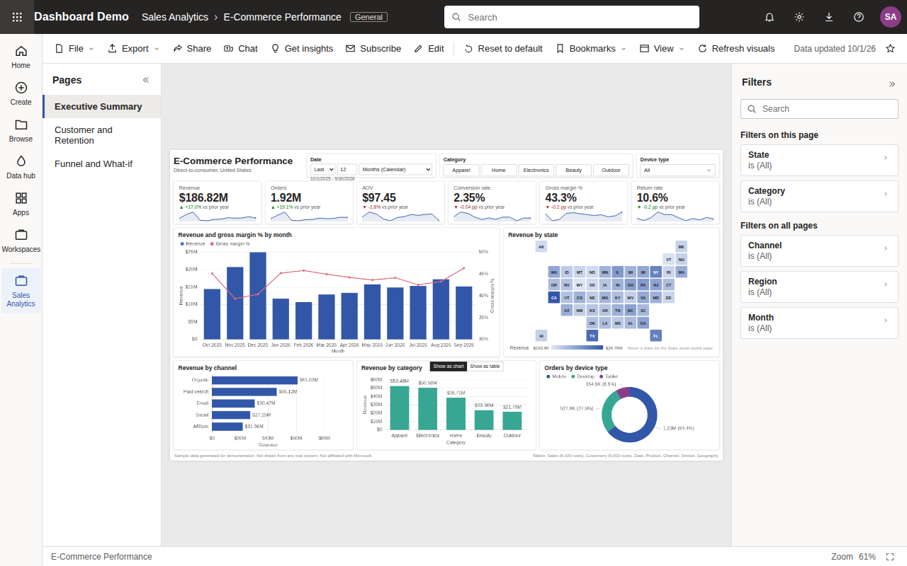
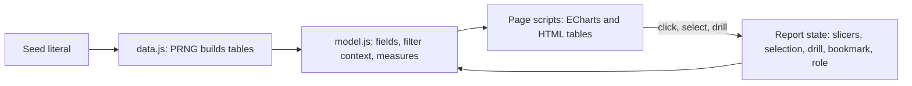
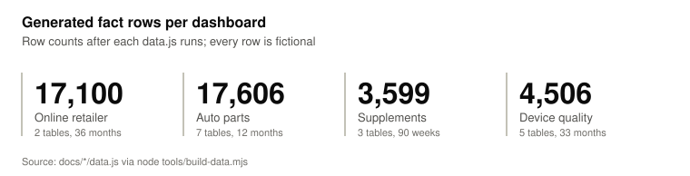
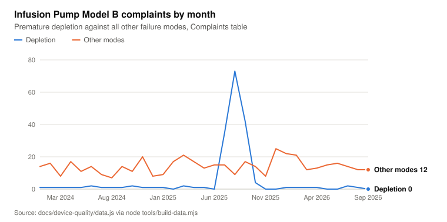
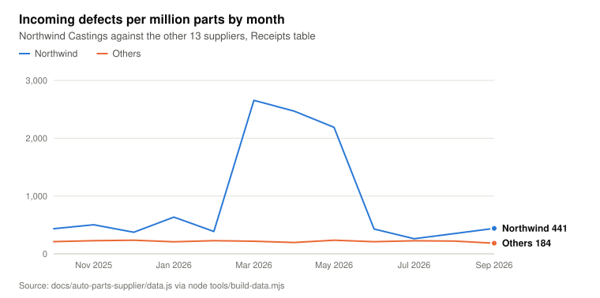

# pbi-portfolio

Four browser dashboards that reproduce Power BI report features in vanilla JavaScript, on seeded fictional data.

<picture>
  
</picture>

The dashboards are vanilla JavaScript reproductions of Power BI report features. Every row of data is generated in the browser from a seeded pseudo-random generator and describes fictional organizations. This project is not affiliated with or endorsed by Microsoft. Power BI is a trademark of the Microsoft group of companies.

The landing page is [docs/index.html](docs/index.html). GitHub Pages serves it from `docs/` at <https://darblinko.github.io/powerbi-dashboards/> once Pages is enabled for the repository.

## What it does

- [Online retailer](docs/online-retailer/): e-commerce sales from Oct 2023 to Sep 2026. Pages Executive Summary, Customer and Retention, Funnel and What-if, and a hidden report page tooltip. Reproduces a state tile map, a cohort retention matrix, key influencers, a conversion funnel, a what-if parameter and a Q&A visual.
- [Auto parts supplier](docs/auto-parts-supplier/): four plants from Oct 2025 to Sep 2026. Pages Plant Performance, Cost and Variance, Supplier Quality, Plant Access (RLS), and a hidden Machine Detail drillthrough page. Reproduces gauges, a field parameter, a Pareto chart, a waterfall, a ribbon chart, a scatter chart with a play axis, and View as for four security roles.
- [Supplement manufacturer](docs/supplement-cmo/): contract manufacturing over 90 weeks from 6 Jan 2025. Pages Production Overview, Quality and Release, Customer Scorecard, and a hidden Batch Record drillthrough page. Reproduces a Gantt schedule, a treemap, a forecast with anomaly detection, a smart narrative, small multiples and a batch genealogy view.
- [Device quality](docs/device-quality/): post-market surveillance for a fictional infusion pump family from Jan 2024 to Sep 2026. Pages Quality Overview, Complaint Trending, CAPA Effectiveness, and a hidden Complaint Detail drillthrough page. Reproduces an individuals control chart, a reportability funnel, a 30-day MDR clock, a decomposition tree and a smart narrative.
- All four: slicers, a filters pane, cross-filtering, 10 bookmarks each, Get insights, and a visual header menu with focus mode, show as table, CSV export, spotlight and View DAX.

Sources: page lists in `docs/*/pages.js`, `docs/supplement-cmo/app.js` and `docs/device-quality/page4.js`; bookmarks in `docs/*/bookmarks.js`; security roles in `ROLES`, `docs/auto-parts-supplier/model.js`.

## How it works



Each dashboard is one HTML page and a set of classic scripts with no build step. `data.js` builds the dimension and fact tables from a fixed seed with a mulberry32 generator: 20261001 for the online retailer, supplement and device dashboards, 16949 for the auto parts dashboard. `model.js` holds the fields, the filter context function and the measures. The page and visual scripts render ECharts 5.5.0 charts and HTML tables from the measures. Interactions update a report state object, and bookmarks save and restore it.

## Generated data

These charts describe the fictional data the pages render. They are not measurements of a real system. `tools/build-data.mjs` (`npm run build:data`) runs each `docs/*/data.js` in Node.js and writes [docs/data.json](docs/data.json); `npm test` fails when that file is out of date.

<picture>
  <source media="(prefers-color-scheme: dark)" srcset="docs/figures/fact-rows-dark.svg">
  
</picture>

<details><summary>Data table</summary>

| Measure         | Value  |
| --------------- | ------ |
| Online retailer | 17,100 |
| Auto parts      | 17,606 |
| Supplements     | 3,599  |
| Device quality  | 4,506  |

Source: `docs/*/data.js via node tools/build-data.mjs`

</details>

The device data plants 34, 72 and 41 extra Model B premature depletion complaints in July, August and September 2025, and 31 and 24 extra Charger charging failure complaints in Europe in February and March 2026 (`docs/device-quality/data.js`, the blocks commented "Planted anomaly").

<picture>
  <source media="(prefers-color-scheme: dark)" srcset="docs/figures/model-b-complaints-dark.svg">
  
</picture>

<details><summary>Data table</summary>

|          | Depletion | Other modes |
| -------- | --------- | ----------- |
| Jan 2024 | 1         | 14          |
| Feb 2024 | 1         | 16          |
| Mar 2024 | 1         | 8           |
| Apr 2024 | 1         | 17          |
| May 2024 | 1         | 11          |
| Jun 2024 | 2         | 14          |
| Jul 2024 | 1         | 9           |
| Aug 2024 | 1         | 7           |
| Sep 2024 | 1         | 14          |
| Oct 2024 | 2         | 11          |
| Nov 2024 | 1         | 20          |
| Dec 2024 | 1         | 8           |
| Jan 2025 | 1         | 9           |
| Feb 2025 | 0         | 17          |
| Mar 2025 | 2         | 21          |
| Apr 2025 | 1         | 17          |
| May 2025 | 1         | 13          |
| Jun 2025 | 0         | 15          |
| Jul 2025 | 35        | 15          |
| Aug 2025 | 73        | 9           |
| Sep 2025 | 42        | 17          |
| Oct 2025 | 4         | 14          |
| Nov 2025 | 0         | 8           |
| Dec 2025 | 0         | 25          |
| Jan 2026 | 1         | 22          |
| Feb 2026 | 1         | 21          |
| Mar 2026 | 1         | 12          |
| Apr 2026 | 1         | 13          |
| May 2026 | 0         | 15          |
| Jun 2026 | 0         | 16          |
| Jul 2026 | 2         | 14          |
| Aug 2026 | 1         | 12          |
| Sep 2026 | 0         | 12          |

Source: `docs/device-quality/data.js via node tools/build-data.mjs`

</details>

<picture>
  <source media="(prefers-color-scheme: dark)" srcset="docs/figures/supplier-ppm-dark.svg">
  
</picture>

<details><summary>Data table</summary>

|          | Northwind | Others |
| -------- | --------- | ------ |
| Oct 2025 | 435       | 212    |
| Nov 2025 | 503       | 228    |
| Dec 2025 | 374       | 236    |
| Jan 2026 | 636       | 209    |
| Feb 2026 | 387       | 228    |
| Mar 2026 | 2,655     | 218    |
| Apr 2026 | 2,469     | 196    |
| May 2026 | 2,189     | 236    |
| Jun 2026 | 430       | 210    |
| Jul 2026 | 262       | 227    |
| Aug 2026 | 350       | 221    |
| Sep 2026 | 441       | 184    |

Source: `docs/auto-parts-supplier/data.js via node tools/build-data.mjs`

</details>

The landing page also charts monthly online retailer revenue and supplement batch dispositions from the same file.

## Quickstart

View the dashboards. This needs Python 3 and network access to cdnjs.cloudflare.com for ECharts.

```bash
git clone https://github.com/darblinko/powerbi-dashboards
cd pbi-portfolio
python3 -m http.server 8000 --directory docs
```

Open <http://127.0.0.1:8000/> and pick a dashboard.

Lint and test. This needs Node.js 22 or later.

```bash
npm ci
npm run lint
npm test
npx playwright install chromium
npm run smoke
```

`npm test` runs the data, link and model regression tests in `tests/*.test.mjs`. `npm run smoke` serves `docs/` on a local port, opens every visible report page and the three drillthrough pages in headless Chromium, and fails on a console error, an uncaught exception, a failed request, a drillthrough page that does not open, a report page with fewer populated ECharts visuals than it lays out, or a landing page figure that does not render.

`npm run build:data` rewrites `docs/data.json`. `npm run build:screenshots` rewrites the dashboard screenshots in `docs/figures/`. The SVG charts in `docs/figures/` are rendered from `docs/data.json` by a chart script kept outside this repository.

## Project layout

```text
docs/
  index.html                landing page (GitHub Pages entry point)
  site.css, charts.js       landing page styles and interactive charts
  data.json                 chart data, generated by tools/build-data.mjs
  figures/                  README and landing figures (SVG charts, PNG screenshots)
  online-retailer/          one directory per dashboard: index.html, data.js,
  auto-parts-supplier/        model.js, page and visual scripts, bookmarks.js,
  supplement-cmo/             style.css
  device-quality/
tools/
  dashboards.mjs            runs a dashboard's data.js and page scripts in node:vm
  build-data.mjs            writes docs/data.json
  screenshots.mjs           writes docs/figures/<dashboard>.png
tests/
  data.test.mjs             row counts, determinism, data.json freshness
  links.test.mjs            relative links in the README and pages resolve
  <dashboard>.test.mjs      measure and interaction regression tests per dashboard
  smoke.mjs                 headless Chromium check of every report page
  static-server.mjs         static file server used by the smoke test and screenshots
eslint.config.js            ESLint flat config
```

## Design decisions and limitations

- No framework and no bundler. The pages are classic scripts so that `docs/` can be served as static files. Scripts on one page share top-level names; `eslint.config.js` reads each file's top-level declarations and declares them as globals for its sibling files.
- Data is generated on page load from a fixed seed, so every visitor sees the same rows. `tests/data.test.mjs` pins the fact table row counts and checks that two runs produce identical data.
- Measures are JavaScript functions. View DAX shows equivalent DAX text; nothing parses or evaluates DAX.
- The Q&A visual matches a fixed grammar of measure, dimension, Top N and filter phrases (`docs/online-retailer/qna.js`).
- Service actions such as Share, Subscribe and Edit show a notice that they are not available.
- The report canvas is laid out for a desktop browser window and scales down. There is no mobile layout.
- ECharts loads from cdnjs without a subresource integrity hash. The charts do not render offline.
- Company, supplier and customer names are fictional, several of them reused from Microsoft sample data (Contoso, Fabrikam, Northwind). Product names and specification limits are invented.
- The tests check row counts, determinism, selected measure values and interactions in Node.js, and that each page renders its charts without errors in Chromium. They do not compare chart values or layouts against Power BI.
- CSS files are excluded from Prettier because the dashboard stylesheets keep one rule per line.

## License

Apache-2.0. See [LICENSE](LICENSE).
